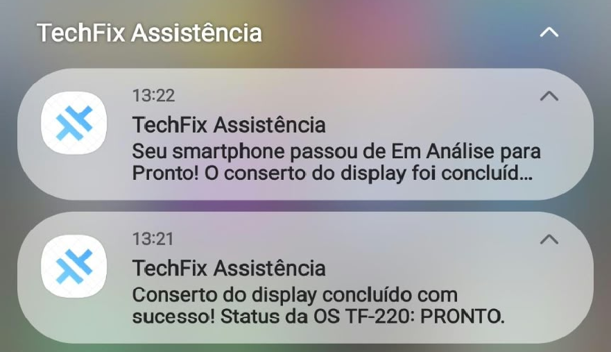

# TechFix Assistência 📱

Aplicativo demonstrativo em React + Capacitor para a atividade 15 — Recursos de Hardware: Notificações Locais.

## O que o aplicativo faz

- Consulta e solicita a permissão nativa de notificações (`checkPermissions` e `requestPermissions`).
- Dispara uma notificação de atualização da OS (Em Análise → Pronto).
- Agenda uma notificação local para alguns segundos no futuro.
- Consulta e cancela notificações pendentes.
- Implementa o desafio extra: botão para consultar o valor da Ordem de Serviço.
- Interface responsiva com identidade visual TechFix.

**Dados demonstrativos:** OS TF-220, troca de display, valor ilustrativo de R$ 349,90. Ajuste esses dados em `src/App.jsx` se necessário.


## Como executar no computador

Requisitos: Node.js 20+ e npm.

```bash
npm install
npm run dev
```

## Publicar no GitHub e gerar o APK

1. Crie um repositório vazio no GitHub, por exemplo `techfix-assistencia`.
2. Extraia este ZIP e abra a pasta `TechFix-Assistencia` no terminal.
3. Execute os comandos:

```bash
git init
git add .
git commit -m "Projeto TechFix Assistencia"
git branch -M main
git remote add origin https://github.com/SEU-USUARIO/techfix-assistencia.git
git push -u origin main
```

4. No GitHub, abra a aba **Actions**. O workflow **Build Android APK** será iniciado automaticamente.
5. Quando aparecer com status verde (**Success**), abra a execução e baixe o arquivo em **Artifacts → TechFix-Assistencia-APK**.
6. Extraia o artifact ZIP. Dentro dele estará `app-debug.apk`, pronto para instalar em um Android.

Para gerar novamente depois de qualquer alteração:

```bash
git add .
git commit -m "Atualiza aplicativo"
git push
```

O GitHub Actions compila um novo APK a cada push na branch `main`.

## Compilar localmente (opcional)

```bash
npm install
npm run build
npx cap add android
npx cap sync android
cd android
./gradlew assembleDebug
```

O APK local ficará em `android/app/build/outputs/apk/debug/app-debug.apk`.

## Teste da atividade

1. Instale o APK em um aparelho Android.
2. Abra o aplicativo e toque em **Ativar** para solicitar a permissão de notificações.
3. Toque em **Testar notificação agora** para disparar a atualização da OS.
4. Escolha 5, 10 ou 15 segundos e toque em **Agendar**. Coloque o app em segundo plano e aguarde.
5. Toque em **Consultar valor** para demonstrar o desafio extra.
6. Grave a tela do celular mostrando a permissão, a notificação e a consulta de valor.

## Observações

- A permissão de notificações é solicitada em tempo de execução no Android 13 ou superior.
- Notificações locais são geradas no próprio aparelho; não precisam de servidor ou internet para disparar depois de agendadas.
- O teste real das notificações deve ser feito em um aparelho/emulador Android. O navegador serve apenas para visualizar a interface.
- O APK gerado pelo workflow é de depuração (`debug`), adequado para demonstração e entrega acadêmica; não é uma versão assinada para publicação na Play Store.
